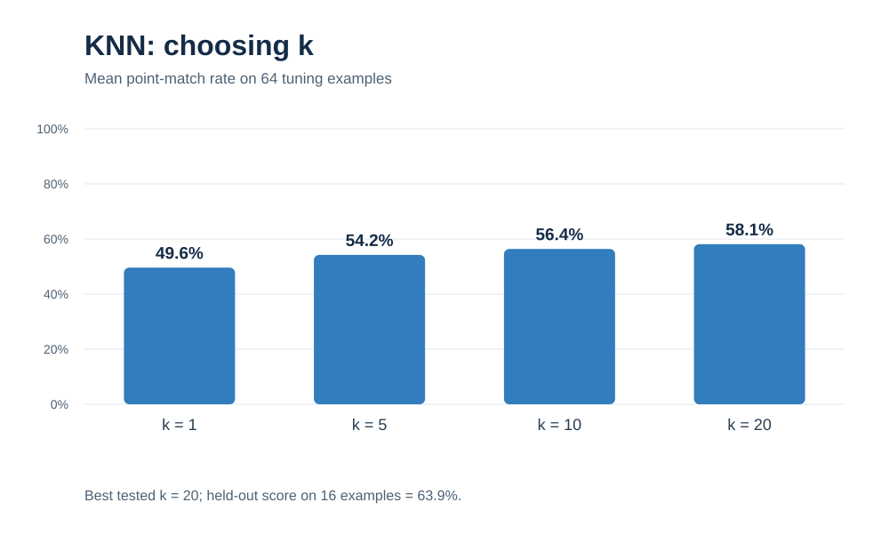
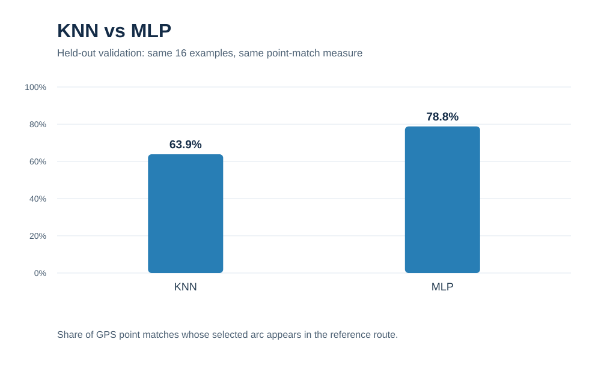

# KNN map matching baseline

This branch contains a nearest-road-segment baseline. For each numbered example, `knn_baseline.py` loads `.nodes`, `.arcs`, and `.track`. It indexes road-segment midpoints with scikit-learn's `NearestNeighbors`, then checks the `k` nearest candidates using point-to-segment distance. Arc IDs are zero-based line numbers in `.arcs`.

KNN fits a separate spatial index for each map. It does not learn one set of weights across all maps. `train_knn.py` selects `k` from labeled examples and evaluates the chosen value on held-out examples.

## Run locally

Keep the supplied data outside this public repository. In PowerShell, from the repository folder:

```powershell
python -m pip install -r requirements.txt
python .\src\knn_baseline.py "C:\path\to\Student folder\train\00000001" --k 20
python .\src\train_knn.py "C:\path\to\Student folder\train"
```

The training script sorts example folders by ID, uses the first 64 for choosing `k`, and holds the remaining 16 out for validation. Its result is saved in `knn_results.json`.

## Current results

The best of `k = 1, 5, 10, 20` was `k = 20`. Mean tuning score was 58.1% across 64 examples; held-out score was 63.9% across 16 examples. The score is the mean fraction of GPS point matches whose selected arc appears anywhere in that example's reference `.route`.

This baseline does not yet connect selected arcs into a complete route. Its score is not a full-route metric and should only be compared with another model using the same examples and scoring definition.

## Charts





