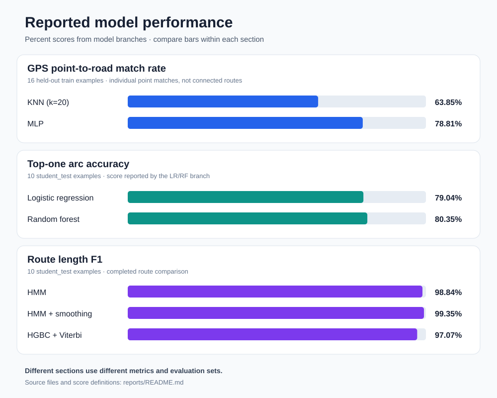
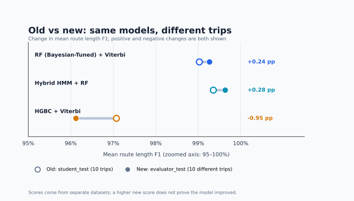
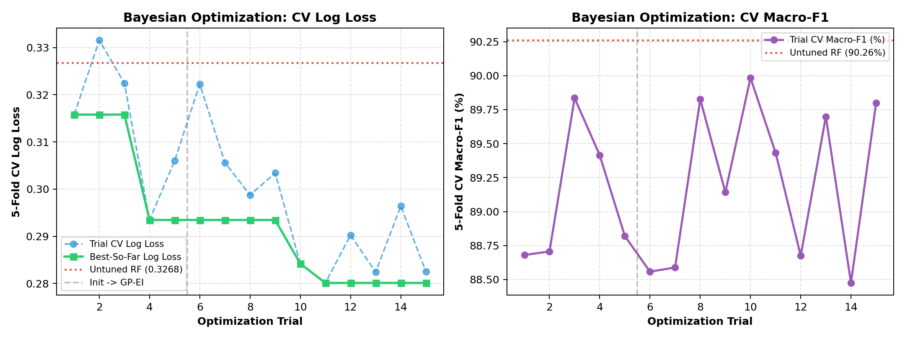
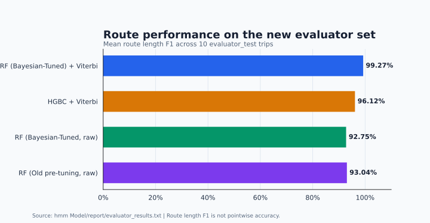

# ML-HACKATHON--Path-Snap
Map matching project that reconstructs road routes from GPS tracks using the supplied road network data. Includes route prediction code, evaluation tools, and generated predictions for the hackathon dataset.

## Model results

The graph groups results by metric and test set. Compare bars within a group only; the percentages across groups measure different things. See [result sources and definitions](reports/README.md).

## Old vs. Bayesian-Tuned Random Forest Comparison

| Model | `student_test` (Len-F1 / Cnt-F1) | `evaluator_test` (Len-F1 / Cnt-F1) |
| :--- | :---: | :---: |
| **RF Regressor (Old, unsmoothed [`lr-rf`](lr-rf/reports/REPORT.md))** | 84.21% / 76.65% | 82.86% / 75.29% |
| **RF Classifier (Old, unsmoothed [`lr-rf`](lr-rf/reports/REPORT.md))** | 80.35% (Top-1) | 84.64% / 77.71% |
| **RF (Old pre-tuning, smoothed raw)** | 92.84% / 81.35% | 93.04% / 81.68% |
| **RF (Bayesian-Tuned, smoothed raw)** | 93.30% / 83.00% | 92.74% / 81.54% |
| **RF (Bayesian-Tuned) + Viterbi** | **99.03%** / **98.47%** | **99.27%** / **98.16%** |

## Old and new dataset results

The two graphs below use **mean route length F1** for the same four HMM-family models. The old `student_test` set and new `evaluator_test` set each contain 10 different trips.

The smoothed HMM scored 99.35% on `student_test` and 99.72% on `evaluator_test` (+0.37 percentage points). The hybrid also scored higher on the new set; the unsmoothed HMM and HGBC scored lower. These are scores on different trips, **not evidence that the models were retrained or improved**. KNN and MLP are absent because they do not have comparable route length F1 results on `evaluator_test`. See the [source scores and calculation](reports/README.md).
