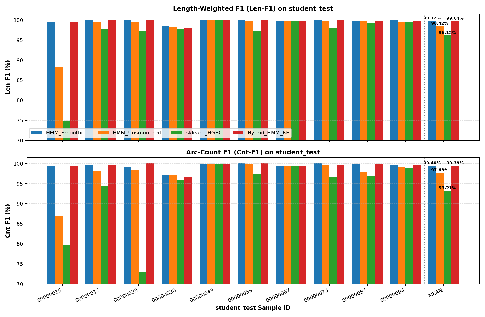
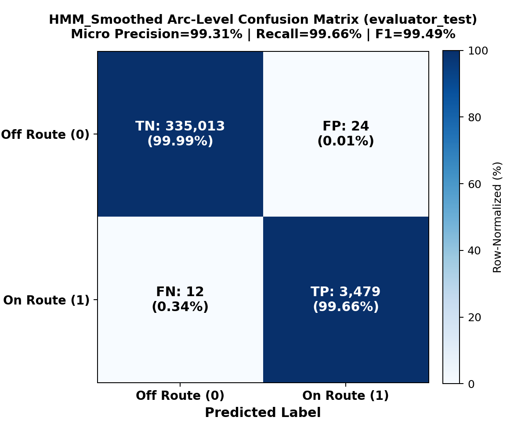

# Evaluator Test Report (`evaluator_test`)

Evaluation of **`HMM_Smoothed`** (`src/baseline_hmm.py`) and **`sklearn_HGBC`** (`models/sklearn_hgbc_hmm.joblib`) on the 10 held-out samples in `evaluator_test/` (`00000015`–`00000094`).

## 1. Summary

| Model | Mean Cnt-F1 | Mean Len-F1 | Arc Top-1 Acc | Exact Route Match |
| :--- | :---: | :---: | :---: | :---: |
| **`Hybrid (Bayes-RF, w=0.5)`** (`models/rf_bayes_tuned.joblib`) | **99.63%** | **99.77%** | **99.9932%** | **4/10 (40%)** |
| **`HMM_Smoothed`** (`src/baseline_hmm.py`) | 99.39% | 99.72% | 99.9894% | 2/10 (20%) |
| **`Hybrid_HMM_RF`** (`models/hybrid_hmm_rf.joblib`) | 99.39% | 99.63% | 99.9882% | 2/10 (20%) |
| **`Pure RF (Bayes-Opt) + Viterbi`** (`src/rf_viterbi.py`) | 98.16% | 99.27% | 99.9784% | 0/10 |
| **`HMM_Unsmoothed`** (`src/baseline_hmm.py`, `use_smoothing=False`) | 97.63% | 98.42% | — | — |
| **`sklearn_HGBC`** (`models/sklearn_hgbc_hmm.joblib`) | 93.21% | 96.12% | — | — |

---

## 2. Arc-Level Confusion Matrix (`HMM_Smoothed`)

Across all **338,528** directed road arcs in the 10 `evaluator_test` graphs:

| | Predicted: Off Route (`0`) | Predicted: On Route (`1`) |
| :--- | :---: | :---: |
| **True: Off Route (`0`)** | **TN: 335,013** (99.99%) | **FP: 24** (0.01%) |
| **True: On Route (`1`)** | **FN: 12** (0.34%) | **TP: 3,479** (99.66%) |

- **Micro Precision**: `99.31%`
- **Micro Recall**: `99.66%`
- **Micro F1**: **`99.49%`**

---

## 3. Per-Sample Breakdown

### `HMM_Smoothed`
| Sample | Pred Arcs | True Arcs | Cnt-F1 | Len-P | Len-R | Len-F1 |
| :--- | :---: | :---: | :---: | :---: | :---: | :---: |
| `00000015` | 139 | 136 | 99.27% | 99.12% | 100.00% | 99.56% |
| `00000017` | 809 | 795 | 99.58% | 99.77% | 100.00% | 99.89% |
| `00000023` | 61 | 59 | 99.16% | 99.94% | 100.00% | 99.97% |
| `00000030` | 341 | 337 | 97.19% | 97.87% | 98.91% | 98.39% |
| `00000049` | 409 | 410 | 99.88% | 100.00% | 99.88% | 99.94% |
| `00000059` | 455 | 455 | **100.00%** | **100.00%** | **100.00%** | **100.00%** |
| `00000067` | 81 | 82 | 99.39% | 100.00% | 99.49% | 99.74% |
| `00000073` | 238 | 238 | **100.00%** | **100.00%** | **100.00%** | **100.00%** |
| `00000087` | 454 | 455 | 99.89% | 100.00% | 99.54% | 99.77% |
| `00000094` | 607 | 604 | 99.59% | 99.90% | 99.96% | 99.93% |
| **MEAN** | — | — | **99.39%** | **99.66%** | **99.78%** | **99.72%** |

### `HMM_Unsmoothed`
| Sample | Cnt-F1 | Len-F1 |
| :--- | :---: | :---: |
| `00000015` | 86.90% | 88.40% |
| `00000017` | 98.28% | 99.56% |
| `00000023` | 98.33% | 99.44% |
| `00000030` | 97.20% | 98.36% |
| `00000049` | 99.88% | 99.94% |
| `00000059` | 99.78% | 99.83% |
| `00000067` | 99.39% | 99.74% |
| `00000073` | 99.58% | 99.72% |
| `00000087` | 97.81% | 99.67% |
| `00000094` | 99.18% | 99.55% |
| **MEAN** | **97.63%** | **98.42%** |

### `sklearn_HGBC`
| Sample | Pred Arcs | True Arcs | Cnt-F1 | Len-P | Len-R | Len-F1 |
| :--- | :---: | :---: | :---: | :---: | :---: | :---: |
| `00000015` | 295 | 136 | 79.65% | 59.87% | 99.80% | 74.84% |
| `00000017` | 886 | 795 | 94.44% | 95.69% | 99.96% | 97.78% |
| `00000023` | 100 | 59 | 72.96% | 95.31% | 99.37% | 97.30% |
| `00000030` | 359 | 337 | 95.97% | 96.31% | 99.48% | 97.87% |
| `00000049` | 409 | 410 | 99.88% | 100.00% | 99.88% | 99.94% |
| `00000059` | 485 | 455 | 97.33% | 94.45% | 100.00% | 97.14% |
| `00000067` | 85 | 82 | 99.39% | 100.00% | 99.49% | 99.74% |
| `00000073` | 260 | 238 | 96.72% | 96.29% | 99.55% | 97.89% |
| `00000087` | 459 | 455 | 96.94% | 99.51% | 99.18% | 99.34% |
| `00000094` | 627 | 604 | 98.85% | 99.11% | 99.66% | 99.38% |
| **MEAN** | — | — | **93.21%** | **93.65%** | **99.64%** | **96.12%** |
