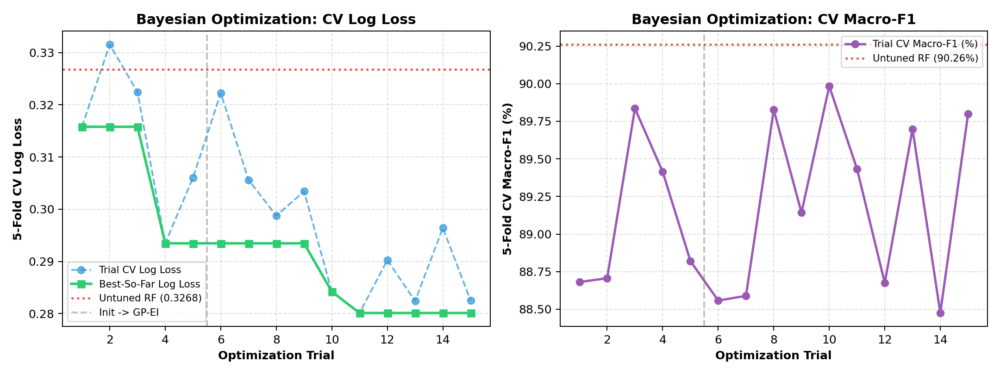
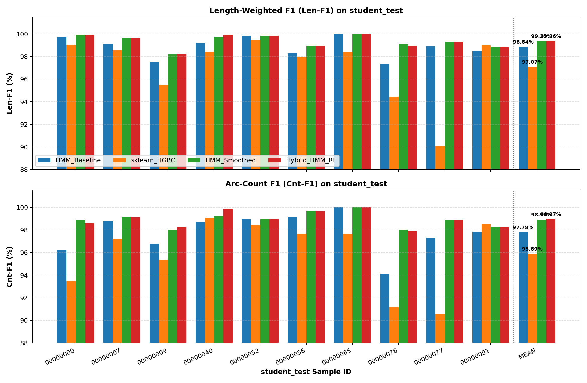
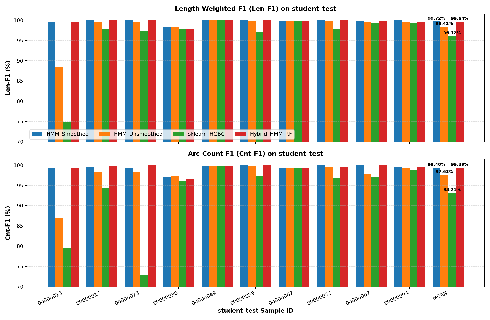

# Hybrid HMM + Random Forest Report (`Hybrid_HMM_RF`)

Combines the **Savitzky–Golay smoothed HMM** (`models/hmm_config.json`) with the trained **Random Forest** (`models/random_forest_model.joblib`, 16 features) into a single log-linear Viterbi decoder (`src/hybrid_hmm_rf.py`), saved as `models/hybrid_hmm_rf.joblib`.

## 1. Scoring Formulation & Weight Tuning

For each transition $(i \to j)$ at subsampled step $t$:

$$\text{score}(i \to j) = \text{dp}[i] + \underbrace{\left(-\frac{|d_{\text{route}} - d_{\text{euclid}}|}{\beta} - \frac{1}{2}\left(\frac{d_j}{\sigma_z}\right)^2\right)}_{\text{HMM score}} + w \cdot \log P_{\text{RF}}(1 \mid x_{i \to j})$$

Weight sweep on `student_test`:

| `rf_weight` ($w$) | Mean Cnt-F1 | Mean Len-F1 | Runtime (10 samples) |
| :---: | :---: | :---: | :---: |
| `0.25` | 98.94% | 99.35% | 8.7s |
| **`0.5`** (selected) | **98.96%** | **99.36%** | 13.2s |
| `1.0` | 98.29% | 98.95% | 9.6s |
| `2.0` | 97.36% | 98.50% | 9.3s |

---

## 2. Benchmark Summary

| Split | Model | Mean Cnt-F1 | Mean Len-P | Mean Len-R | Mean Len-F1 | Arc Top-1 Acc | Exact Route Match |
| :--- | :--- | :---: | :---: | :---: | :---: | :---: | :---: |
| **`student_test`** | **`Hybrid_HMM_RF (w=0.5)`** | **98.96%** | 99.05% | **99.67%** | **99.36%** | **99.9670%** | **1/10 (10%)** |
| **`student_test`** | `HMM_Smoothed` | 98.92% | **99.09%** | 99.63% | 99.35% | 99.9649% | **1/10 (10%)** |
| **`student_test`** | `Hybrid (Bayes-RF, w=0.5)` | 98.88% | — | — | 99.33% | 99.9643% | 0/10 |
| **`student_test`** | `Pure RF (Bayes-Opt) + Viterbi` | 98.47% | — | — | 99.02% | 99.9330% | 0/10 |
| **`evaluator_test`** | **`Hybrid (Bayes-RF, w=0.5)`** | **99.63%** | — | — | **99.77%** | **99.9932%** | **4/10 (40%)** |
| **`evaluator_test`** | `HMM_Smoothed` | 99.39% | **99.66%** | **99.78%** | 99.72% | 99.9894% | 2/10 (20%) |
| **`evaluator_test`** | `Hybrid_HMM_RF (w=0.5)` | 99.39% | 99.52% | 99.75% | 99.63% | 99.9882% | 2/10 (20%) |
| **`evaluator_test`** | `Pure RF (Bayes-Opt) + Viterbi` | 98.16% | — | — | 99.27% | 99.9784% | 0/10 |

---

## 3. Per-Sample Results (`Hybrid_HMM_RF`, `w=0.5`)

### `student_test` (10 samples)
| Sample | Pred Arcs | True Arcs | Cnt-F1 | Len-F1 |
| :--- | :---: | :---: | :---: | :---: |
| `00000000` | 184 | 179 | 98.62% | 99.89% |
| `00000007` | 121 | 123 | 99.18% | 99.65% |
| `00000009` | 436 | 429 | 98.27% | 98.22% |
| `00000040` | 310 | 309 | 99.84% | 99.90% |
| `00000052` | 93 | 95 | 98.94% | 99.84% |
| `00000056` | 1320 | 1323 | 99.72% | 98.96% |
| `00000065` | 145 | 145 | **100.00%** | **100.00%** |
| `00000076` | 390 | 374 | 97.91% | 98.96% |
| `00000077` | 272 | 268 | 98.89% | 99.32% |
| `00000091` | 232 | 232 | 98.28% | 98.82% |
| **MEAN** | — | — | **98.96%** | **99.36%** |

### `evaluator_test` (10 samples)
| Sample | Pred Arcs | True Arcs | Cnt-F1 | Len-F1 |
| :--- | :---: | :---: | :---: | :---: |
| `00000015` | 139 | 136 | 99.27% | 99.56% |
| `00000017` | 801 | 795 | 99.65% | 99.89% |
| `00000023` | 59 | 59 | **100.00%** | **100.00%** |
| `00000030` | 344 | 337 | 96.62% | 97.92% |
| `00000049` | 409 | 410 | 99.88% | 99.94% |
| `00000059` | 455 | 455 | **100.00%** | **100.00%** |
| `00000067` | 81 | 82 | 99.39% | 99.74% |
| `00000073` | 240 | 238 | 99.58% | 99.90% |
| `00000087` | 454 | 455 | 99.89% | 99.77% |
| `00000094` | 605 | 604 | 99.59% | 99.63% |
| **MEAN** | — | — | **99.39%** | **99.63%** |
