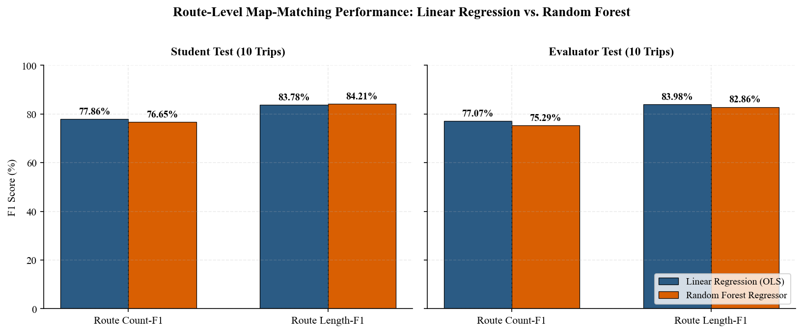
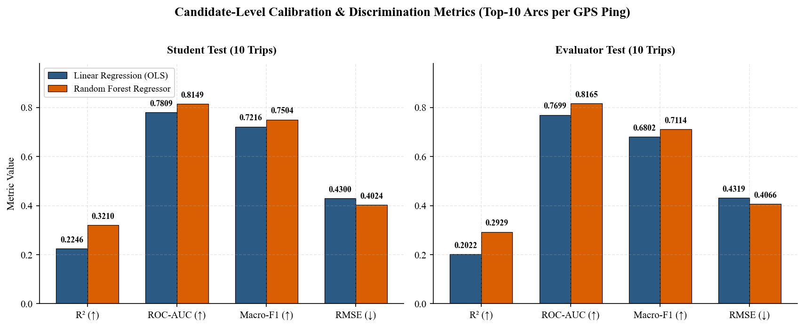
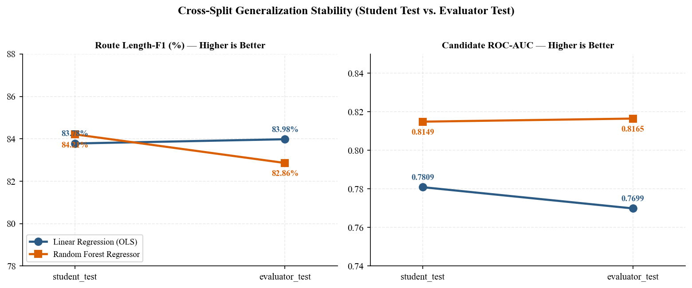
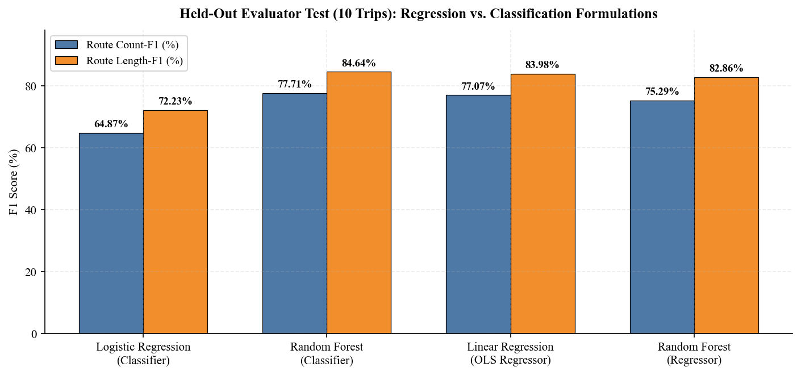

# Pointwise Map-Matching Evaluation: Linear Regression vs. Random Forest

## 1. Objective & Scope
This module evaluates **pointwise candidate-scoring models**—comparing linear models (**Linear Regression (OLS)** and **Logistic Regression**) against non-linear tree ensembles (**Random Forest Regressor** and **Random Forest Classifier**)—for GPS-to-road-network map matching without sequential post-processing.

---

## 2. Feature Engineering & Experimental Setup
* **Candidate Generation:** For every GPS observation, the top-$K$ ($K=10$) nearest road arcs are retrieved using vectorized equirectangular projection and chunked orthogonal segment projection (`chunk_size=256`).
* **16 Engineered GPS-to-Arc Features:**
  1. **Spatial Proximity (4):** Perpendicular distance (`perp_dist`), within-ping rank (`dist_rank`), gap to closest arc (`dist_diff_min`), and distance ratio (`dist_ratio`).
  2. **Kinematic & Directional Alignment (5):** Angular difference (`heading_diff`), cosine heading alignment (`cos_heading_diff`), instantaneous speed (`speed_mps`), step displacement (`step_dist`), and sampling interval (`dt`).
  3. **Road Geometry & Topology (4):** Arc length (`arc_length`), normalized projection position (`proj_pos_ratio`), start-node in-degree (`u_in_deg`), and end-node out-degree (`v_out_deg`).
  4. **Local Transition Continuity (3):** Same-arc indicator (`is_same_arc`), direct topological connection to previous Top-1 arc (`is_direct_conn`), and Euclidean connection gap (`conn_gap_dist`).
* **Dataset Splits:**
  * **Training:** 40 trajectories (`data/Student folder/train`)
  * **Validation (`student_test`):** 10 held-out trajectories
  * **Final Evaluation (`evaluator_test`):** 10 unseen trajectories

---

## 3. Quantitative Benchmark Results

### 3.1 Regression Formulation (`src/06_eval_linreg_vs_rf.py`)
Models predict continuous arc-membership scores $y \in \{0, 1\}$, and each GPS ping selects the highest-scoring candidate arc ($rg\max_a \hat{y}_a$), followed by consecutive duplicate compression.

| Split | Model | RMSE (↓) | $R^2$ (↑) | ROC-AUC (↑) | Candidate Macro-F1 (↑) | Route Count-F1 (↑) | Route Length-F1 (↑) |
| :--- | :--- | :---: | :---: | :---: | :---: | :---: | :---: |
| **`student_test` (10 trips)** | Linear Regression (OLS) | 0.4300 | 0.2246 | 0.7809 | 0.7216 | **77.86%** | 83.78% |
| **`student_test` (10 trips)** | **Random Forest Regressor** | **0.4024** | **0.3210** | **0.8149** | **0.7504** | 76.65% | **84.21%** |
| **`evaluator_test` (10 trips)** | Linear Regression (OLS) | 0.4319 | 0.2022 | 0.7699 | 0.6802 | **77.07%** | **83.98%** |
| **`evaluator_test` (10 trips)** | **Random Forest Regressor** | **0.4066** | **0.2929** | **0.8165** | **0.7114** | 75.29% | 82.86% |

### 3.2 Classification Formulation (`evaluator_test`, 10 Trips)

| Split | Model | Candidate Macro-F1 (↑) | Log Loss (↓) | Route Count-F1 (↑) | Route Length-F1 (↑) |
| :--- | :--- | :---: | :---: | :---: | :---: |
| **`evaluator_test` (10 trips)** | Logistic Regression | **0.5621** | **1.5484** | 64.87% | 72.23% |
| **`evaluator_test` (10 trips)** | **Random Forest Classifier** | 0.5541 | 1.7106 | **77.71%** | **84.64%** |

---

## 4. Visual Analysis

### 4.1 Route-Level Count-F1 & Length-F1

### 4.2 Candidate-Level Calibration & Discrimination

### 4.3 Cross-Split Generalization Stability

### 4.4 Regression vs. Classification Formulations (`evaluator_test`)

---

## 5. Key Findings & Error Analysis
1. **Superior Candidate Scoring by Random Forest:** Across both held-out splits, **Random Forest Regressor** outperforms **Linear Regression (OLS)** on every candidate-level metric—cutting `RMSE` from `0.4319` to **`0.4066`**, raising $R^2$ from `0.2022` to **`0.2929`** (**+44.9% relative gain**), and increasing `ROC-AUC` from `0.7699` to **`0.8165`** on `evaluator_test`. Tree splits capture non-linear interactions between perpendicular distance (`perp_dist`), heading alignment (`cos_heading_diff`), and topological continuity (`is_direct_conn`).
2. **Classifier Gap (+12.41 pp Length-F1):** Under binary classification on `evaluator_test`, **Random Forest Classifier** (`84.64%` Length-F1, `77.71%` Count-F1) beats **Logistic Regression** (`72.23%` Length-F1, `64.87%` Count-F1) by **+12.41 percentage points**, confirming that a single linear hyperplane struggles with multi-lane and intersection geometry.
3. **Greedy Top-1 Tie-Breaking Behavior:** Under continuous OLS regression, **Linear Regression** slightly edges out **Random Forest Regressor** on `evaluator_test` route F1 (`83.98%` vs. `82.86%` Length-F1) because continuous linear combinations assign distinct real-valued scores to closely spaced parallel arcs, whereas shallow (`max_depth=12`) tree leaves can assign identical average leaf values to candidates falling in the same terminal node.
4. **Inherent Ceiling of Pointwise Models (~83%–85% Length-F1):** Evaluating each GPS ping independently without global path constraints causes occasional arc-hopping at dense urban intersections, bounding standalone pointwise accuracy around `84.6%` Route Length-F1.
